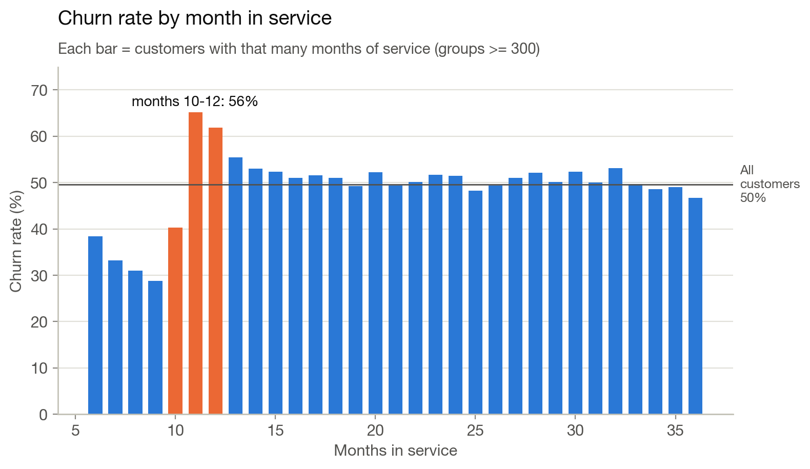
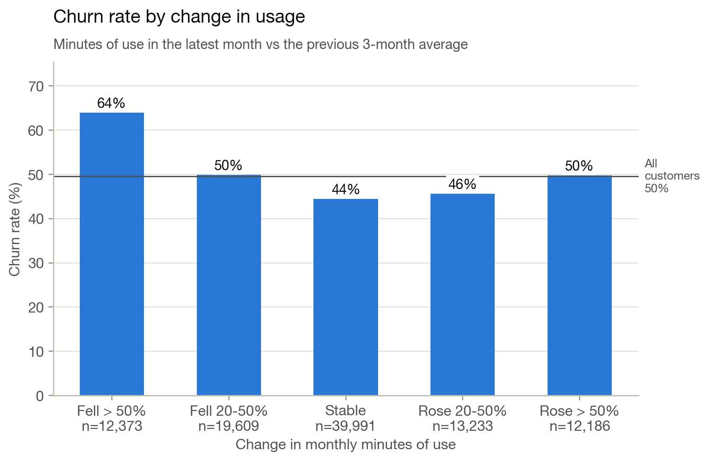
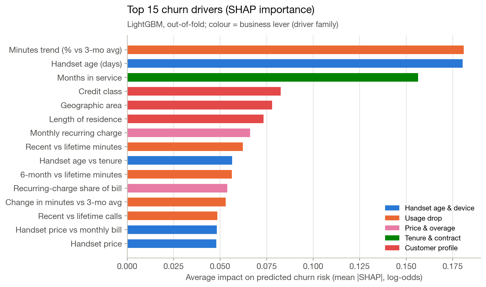
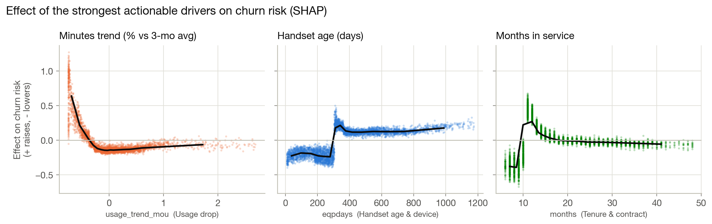
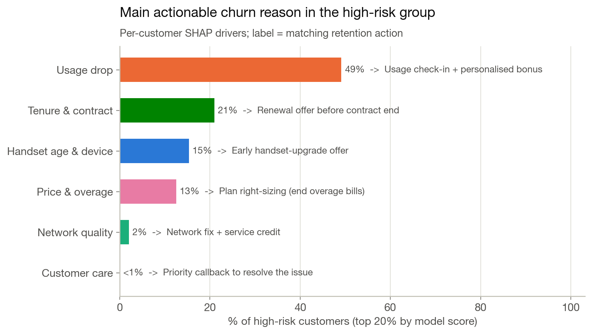
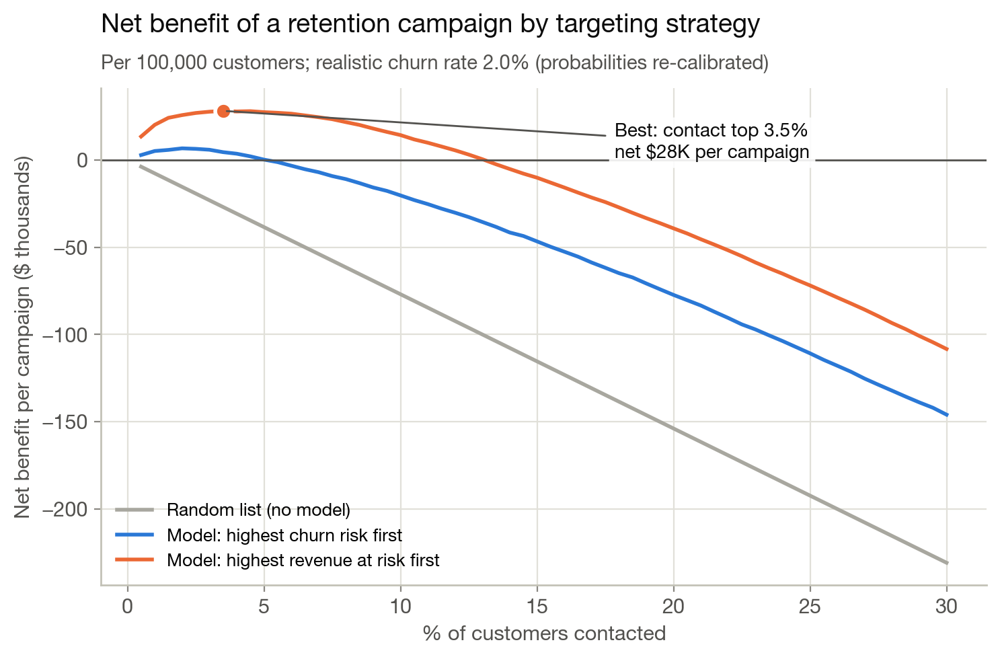

# Company A: churn prediction and a data-driven retention proposal

Predicting which telecom customers are about to leave, explaining **why** each one is at risk, and putting a dollar value on keeping them.

Final assignment for the **GCI World 2026 (September cohort)** data science course. The scenario: as an IT consulting associate, analyse a telecom client’s customer data, build a machine-learning model, define the client’s core problem from the evidence and US market research, and make a business proposal with quantified impact.

📊 **Slides:** [`slides/Company_A_Retention_Proposal.pdf`](slides/Company_A_Retention_Proposal.pdf)

---

## Key findings

| | Finding |
|---|---|
| **The first-year cliff** | Churn more than doubles around the first anniversary: **29% at month 9 → 65% at month 11** of service. The same jump appears when the handset passes ~10 months old (37% → 60%). |
| **Early warning sign** | Customers whose monthly minutes fell by more than half churn at **64%**, vs **44%** for stable users. |
| **What does *not* drive churn** | Dropped calls (52% vs 48%) and overage barely move churn; customers who call customer care churn *less* (45% vs 52%). |
| **Where the money is** | Customers with a $100+ bill are 11% of leavers but **29% of lost revenue**. |
| **Best model** | **LightGBM, ROC-AUC 0.706** (5-fold cross-validation, ±0.002), best of four models. |
| **Business impact** | Contacting the top 3.5% of customers by *revenue at risk* each month earns **+$28K net per campaign per 100,000 customers (ROI 70%)**; the same campaign sent to a random list loses $27K. |
| **Fairness** | Ethnicity is excluded from every model. Including it would add only 0.0015 AUC. |

> Churn rates come from a balanced study sample (49.6% churners), so compare groups rather than absolute levels. All money figures use probabilities re-calibrated to a realistic 2% monthly churn.

<p align="center">
  
  
</p>

---

## Approach

1. **Data:** two files (customer profile and usage records) joined on `Customer_ID`: 100,000 customers, 99 variables. 43 variables have missing values; anomalies (negative bills, negative handset ages) are flagged.
2. **Exploratory analysis:** churn rate by handset age, tenure, usage change, care calls, dropped calls, overage, handset price and bill size, plus 10 categorical customer attributes. A single-column AUC check confirms there is no target leakage.
3. **Feature engineering:** 18 new features, such as usage trend vs the 3-month average, recent vs lifetime usage, handset age relative to tenure, dropped-call rate and recurring-charge share of the bill.
4. **Modelling:** four models compared with 5-fold stratified cross-validation (out-of-fold predictions, seed 42).
5. **Explainability:** TreeSHAP values from LightGBM (`pred_contrib=True`) grouped into driver families. Each high-risk customer gets a *reason code* (their strongest actionable driver) and a matching retention action.
6. **Business simulation:** probabilities re-calibrated from the 50/50 sample to a realistic churn rate (Saerens et al., 2002); three targeting strategies compared; sensitivity analysis on churn rate, save rate and offer value.

### Model comparison

| Model | ROC-AUC | Accuracy | F1 | Leavers found in top 20% |
|---|---:|---:|---:|---:|
| Logistic regression | 0.642 | 0.603 | 0.594 | 26.7% |
| Random forest | 0.689 | 0.633 | 0.635 | 29.2% |
| XGBoost (tutorial settings) | 0.703 | 0.644 | 0.642 | 30.0% |
| **LightGBM (chosen)** | **0.706** | **0.647** | **0.645** | **30.2%** |

ROC-AUC is the main metric because the business task is *ranking* customers for a limited contact budget. In plain terms, the model rates a real leaver as riskier than a stayer 71% of the time, and 75% of the customers it flags in the top 20% really leave (vs 50% at random).

<p align="center">
  
  
</p>

### From model to action

| Main reason (top 20% risk group) | Share | Churn | Avg bill | Revenue at risk / month | Action |
|---|---:|---:|---:|---:|---|
| Usage drop | 49% | 80% | $45 | $343K | Check-in call + usage bonus |
| Tenure and contract | 21% | 71% | $61 | $182K | Renewal offer at month 9–10 |
| Handset age | 15% | 68% | $50 | $105K | Early handset-upgrade offer |
| Price and overage | 13% | 70% | $87 | $153K | Right-size plan, end overage |
| Network quality | 2% | 66% | $61 | $17K | Network fix + service credit |

### Business impact assumptions (US market)

| Assumption | Base case | Source |
|---|---|---|
| Monthly churn rate | 2% (tested 1–3%) | Big 3 carriers 0.86–0.99% [1]; cable operators ≈2% [2] |
| Cost per retention call | $5 | Outbound call centres $10–50/hour [7] |
| Offer value (paid only if accepted) | $60 (tested $30–90) | Assumption, e.g. $10/month credit for 6 months |
| Share of reached leavers who stay | 25% (tested 15–35%) | Assumption; cross-checked against “up to 15% churn reduction” [4] |
| Loyal customers who also take the offer | 10% | Assumption |
| Revenue counted per saved customer | 12 months | Conservative; US device plans run 36 months [3] |

<p align="center">
  
  
</p>

---

## Repository structure

```
.
├── README.md
├── LICENSE
├── requirements.txt
├── telecom_analysis.py        # the full analysis: EDA → models → SHAP → business simulation
├── slides/
│   └── Company_A_Retention_Proposal.pdf
├── results/                   # outputs of one full run
│   ├── summary.txt            # every number used in the slides
│   ├── fig01 … fig14 .png     # charts (plus fig02b / fig03b detail charts)
│   ├── segment_tables.csv     # churn rate by customer segment
│   └── reason_codes_high_risk.csv
└── data/                      # put Client.csv and Record.csv here (not included)
```

## How to run

Tested with Python 3.12 on macOS (Apple Silicon).

```bash
git clone https://github.com/<your-username>/company-a-churn-retention.git
cd company-a-churn-retention
pip install -r requirements.txt

# copy Client.csv and Record.csv into data/
python telecom_analysis.py
```

A full run takes about 5–10 minutes on a laptop. It prints progress after each model and fold, and writes everything to `results/`. For a quick 1–2 minute test on a sample, set `FAST = True` at the top of the script. The business assumptions live in the `ASSUME` dictionary in the settings block.

## Data

The Company A dataset (`Client.csv`, `Record.csv`) was provided to course participants and is **not included** in this repository. The script finds the two files anywhere up to three folders below it (for example in `data/`).

## Limitations

- **Balanced sample.** The data contains ~50% churners, far above real-world rates, so the business case re-scales probabilities and tests churn rates of 1–3%.
- **Cause of the first-year cliff.** The data has no contract-end field, so the link to one-year agreements or handset deals is a hypothesis to confirm in a pilot.
- **Prediction is not persuasion.** A churn model finds who will leave, not who will respond to an offer. The proposal therefore includes a pilot with a control group before scaling.
- **Illustrative economics.** Costs and save rates are sourced or stated assumptions, not Company A’s actual figures.

## References

1. TelecomLead (29 Sep 2026). *Telecom churn rate 2026: how operators are retaining customers through convergence and better networks.* https://telecomlead.com/?p=127911
2. Entner, R. (31 Jul 2026). *Each carrier nailed its Q2 plan but buried the number that shows the cost.* Light Reading. https://www.lightreading.com/wireless/each-carrier-nailed-its-q2-plan-but-buried-the-number-that-shows-the-cost
3. Alleven, M. (3 Feb 2022). *Verizon extends device payment plans to 36 months.* Fierce Network. https://www.fierce-network.com/wireless/verizon-extends-device-payment-plans-36-months
4. Jain, P., & Surana, K. (12 Dec 2017). *Reducing churn in telecom through advanced analytics.* McKinsey & Company. https://www.mckinsey.com/industries/technology-media-and-telecommunications/our-insights/reducing-churn-in-telecom-through-advanced-analytics
5. Ke, G., et al. (2017). *LightGBM: a highly efficient gradient boosting decision tree.* NeurIPS 30. https://proceedings.neurips.cc/paper/2017/file/6449f44a102fde848669bdd9eb6b76fa-Paper.pdf
6. Lundberg, S. M., et al. (2020). *From local explanations to global understanding with explainable AI for trees.* Nature Machine Intelligence, 2, 56–67. https://pubmed.ncbi.nlm.nih.gov/32607472/
7. Twilio (22 Nov 2025). *How much does call center outsourcing cost?* https://www.twilio.com/en-us/blog/call-center-services-pricing
8. Saerens, M., Latinne, P., & Decaestecker, C. (2002). *Adjusting the outputs of a classifier to new a priori probabilities: a simple procedure.* Neural Computation, 14(1), 21–41. https://mlanthology.org/neco/2002/saerens2002neco-adjusting

## AI assistance

This project was built with help from Claude (Anthropic), a generative AI assistant, for the analysis code, research and slide drafting, as disclosed in the course submission. All results come from running `telecom_analysis.py` locally on the course data.

## License

The code is released under the [MIT License](LICENSE). The dataset and course materials are not covered by this license.

---

**Author:** Roya Nikseresht
